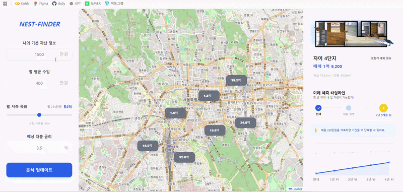

## 🏠 자산 기반 부동산 구매 시뮬레이션 대시보드

> 현재 자산과 저축 계획을 기반으로 매수 가능한 부동산 매물을 탐색하고 <br>
> 미래 자산 흐름을 시뮬레이션하는 웹 대시보드입니다. <br>
> 사용자의 자산 상황에 맞춰 예상 매수 시점과 자산 변화를 시각적으로 보여줍니다.

<br>

### 🎞 Preview

<p align="center">

</p>
<br>

## ⁘ 기능 소개

#### 1. 지도 기반 매물 탐색

Leaflet.js를 활용하여 매물 위치를 지도 위 마커로 표시합니다.  
사용자는 지도에서 매물을 선택해 가격 정보를 확인할 수 있습니다.

#### 2. 자산 기반 매수 시점 계산

사용자의 현재 자산과 월 저축액을 기준으로  
선택한 매물을 구매하기까지 필요한 예상 기간을 계산합니다.

#### 3. 자산 성장 그래프

Chart.js를 사용해 향후 자산 변화를 그래프로 시각화합니다.  
저축액을 변경하면 그래프가 함께 업데이트됩니다.

#### 4. 대시보드 UI

지도와 자산 분석 결과를 한 화면에서 확인할 수 있도록  
Grid 레이아웃 기반의 대시보드 형태로 구성했습니다.

<br>

## ▶ 설치 및 실행

요구 사항: Node.js `^22.12.0 || ^24.0.0 || >=26.0.0` (테스트 도구 Vitest 5의 요구 사항과 같음. 검증 환경: Node.js 24.21.0 LTS, npm 11.19.0)

```bash
npm ci        # package-lock.json 기준으로 의존성 설치
npm start     # http://localhost:3000
```

- 개발 중 파일이 바뀌면 자동으로 재시작: `npm run dev`
- 다른 포트 사용: `PORT=4000 npm start`
- 포트가 이미 사용 중이면 시작 실패 메시지를 출력하고 종료 코드 1로 끝납니다.

### 테스트

```bash
npx playwright install chromium   # 처음 한 번: Playwright가 고정한 Chromium 설치
npm test                          # Vitest: 계산 모듈 단위 테스트 + 서버 기동 테스트
npm run test:e2e                  # Playwright: 브라우저 통합 테스트
npm run test:all                  # 둘 다 실행
```

- 브라우저 테스트는 개발 서버(3000)와 분리된 테스트 포트 3100에서 서버를 직접 띄웁니다. 포트를 바꾸려면 `TEST_PORT=3200 npm run test:e2e`를 사용하세요.
- 테스트 포트가 이미 사용 중이면 다른 서버를 잘못 테스트하지 않도록 즉시 실패합니다.
- 테스트 도구 버전: Vitest 5.0.5, @playwright/test 1.64.1 (Chromium 156.0.8078.4)

<br>

## 📂 프로젝트 구조 </b>

<br>

```
nest-finder
│
├── data
│   └── data.js        # 매물 데이터
│
├── public
│   ├── assets         # 이미지
│   ├── calc           # 계산 순수 함수 (ES Module, UI와 테스트가 공유)
│   │   ├── input.js         # 입력 검증 (만원 단위 정수, 천 단위 쉼표)
│   │   ├── affordability.js # 자산 비율·부족 금액
│   │   ├── simulate.js      # 목표 도달 시뮬레이션 (연 2% 복리, 최대 600개월)
│   │   └── format.js        # 금액·기간·비율 표시 형식
│   ├── index.html     # 메인 페이지
│   ├── script.js      # 화면 렌더링과 이벤트 처리 (ES Module)
│   └── style.css      # UI 스타일
│
├── tests
│   ├── unit           # Vitest: 계산 모듈 단위 테스트
│   ├── server         # Vitest: 서버 기동·PORT·포트 충돌 테스트
│   └── e2e            # Playwright: 브라우저 통합 테스트
│
├── server.js          # Express 서버 (PORT 환경변수, 기본 3000)
├── vitest.config.mjs
└── playwright.config.mjs
```

<br>

## ⚙ Tech Stack

- JavaScript
- Node.js
- Express
- Leaflet.js
- Chart.js
